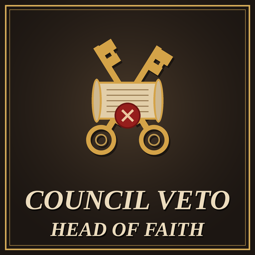

# Head of Faith Council Veto

A Crusader Kings III mod that makes the Head of Faith the guardian of the faith at Ecumenical Councils called by the AI. In vanilla, the Head of Faith is just one more vote: an AI archbishop can call a council, gather a majority and change the faith's tenets and doctrines without the Pope's consent. With this mod, an AI council needs the Head of Faith present, and an AI Head of Faith always opposes and vetoes the changes. Councils you call, or that the Head of Faith calls, work as in vanilla.

- **Game version:** 1.20.x
- **Mod version:** 1.1.1
- **Author:** [Sourenics](https://github.com/Sourenics)
- **Steam Workshop:** [Head of Faith Council Veto](https://steamcommunity.com/sharedfiles/filedetails/?id=3826064881)

> **⚠️ Not compatible with [Protected Rites](https://github.com/Sourenics/CK3-Protected-Rites) 1.1.0 or later.** See [Compatibility](#compatibility).

## Features

At an **Ecumenical Council hosted by an AI** who is not the Head of Faith:

- **The Head of Faith must attend.** An AI Head of Faith is added to the council when it is called, if they can join it. If the Head of Faith never joins, the council is cancelled when it begins, and players attending it are told why.
- **An AI Head of Faith always opposes.** They start every debate as a Conservative, are never moved to the Innovators and cannot be swayed, so they argue against the host in the debates.
- **The Head of Faith's opposition is a veto.** If the Head of Faith opposes a proposal, it fails even with a majority, and the result says that the Head of Faith vetoed it. An AI Head of Faith always does; a player Head of Faith only when they choose to oppose. A Head of Faith who is absent at the vote (for example, a new one after the previous one died) cannot approve anything either.

**Everything else stays vanilla:**

- **Councils hosted by a player, or by a player's theological puppet:** the Head of Faith may stay away, the council is not cancelled, and they vote by their own judgement, as any attendee, with no veto.
- **Councils hosted by the Head of Faith:** unchanged.
- **Faiths without a Head of Faith:** unchanged.

With an AI Head of Faith, a council called by another AI will never change the faith. AI rulers still call councils and pay for them as usual.

### When the mod applies

By default, the mod applies **after the Great Schism**: from the start in games that begin after it, such as the 1066 and 1178 bookmarks, and from the moment it happens in an 867 game. Before the Schism, and for the whole game if the Schism is prevented, Ecumenical Councils work as in vanilla. The game rule **HFCV: Head of Faith Council Veto** can be set to **Always** to apply the mod for the whole game.

### Languages

The messages are in English and Spanish; players using any other game language see them in English. Translations are welcome: open an [issue](../../issues/new/choose) or post them on the Steam Workshop page.

## Installation

### Steam Workshop

Subscribe on the Steam Workshop page and enable the mod in the Paradox launcher.

### Manual

1. Download this repository (green **Code** button → **Download ZIP**).
2. Copy the contents of the `mod/` folder (`head_of_faith_council_veto/` and `head_of_faith_council_veto.mod`) into:
   - **Windows:** `Documents/Paradox Interactive/Crusader Kings III/mod/`
   - **Linux:** `~/.local/share/Paradox Interactive/Crusader Kings III/mod/`
   - **macOS:** `~/Documents/Paradox Interactive/Crusader Kings III/mod/`
3. Enable **Head of Faith Council Veto** in the Paradox launcher.

## Compatibility

> **⚠️ Not compatible with [Protected Rites](https://github.com/Sourenics/CK3-Protected-Rites) 1.1.0 or later.** Both mods replace the vote tally of Ecumenical Councils (`ecumenical_council_events.0080`), so only one of them works at councils: if both are loaded, the game uses the one from Protected Rites and the Head of Faith's veto does not apply. Use only one of them. From version 1.1.1 (and Protected Rites 1.1.0), an event tells you once per game if both are loaded.

- Requires **By God Alone**, which adds the Ecumenical Council.
- Overrides three vanilla scripted effects from `pam_ecumenical_council_effects.txt` in its own file (`pam_ecumenical_council_host_start_catalyst_effect`, `ecumenical_council_become_innovator_effect` and `pam_sort_guests_into_ecumenical_council_groups_effect`), and the vote tally event `ecumenical_council_events.0080` through `id_override_priority`. Each is a copy of the vanilla script with small, marked changes. Other mods that change the same effects or event are not compatible without a patch. It also adds to the `ecumenical_council_summons_events`, `on_game_start_after_lobby` and `yearly_global_pulse` on_actions without overriding them.
- Compatible with the Unofficial Patch, which only changes an unrelated line of the council.
- Can be added to an existing save; best added when no council is in progress, since a council called before it was enabled did not summon the Head of Faith. Can be removed at any time.

## Reporting bugs

Please open an [issue](../../issues/new/choose) using the **Bug report** template. To be able to fix the problem we need:

1. **The `error.log` file** from the session where the problem happened:
   - **Windows:** `Documents/Paradox Interactive/Crusader Kings III/logs/error.log`
   - **Linux:** `~/.local/share/Paradox Interactive/Crusader Kings III/logs/error.log`
   - **macOS:** `~/Documents/Paradox Interactive/Crusader Kings III/logs/error.log`

   The log is overwritten every time the game starts, so copy it right after the problem happens, before launching the game again. Ideally, reproduce the problem in a session with **only Head of Faith Council Veto enabled**.
2. **The game version** (shown in the main menu, for example 1.20.1) and **the mod version**.
3. **Your active DLCs** and **your full mod list in load order**.
4. **The council:** who hosted it (player, player's puppet or AI), whether the Head of Faith is a player or AI and attended, and what happened in the vote.
5. **Screenshots** of the council window and the vote result, if possible.

## Credits

Idea and testing by Sourenics.

## License

**Head of Faith Council Veto** © 2026 Sourenics, licensed under [Creative Commons Attribution-ShareAlike 4.0 International (CC BY-SA 4.0)](https://creativecommons.org/licenses/by-sa/4.0/).

Forks, translations and alternative versions are welcome, provided that you:

- **Credit the original author** (Sourenics) and link to this repository.
- **Indicate the changes** you made.
- **Release your version under the same license** (CC BY-SA 4.0).

### Paradox Interactive content

Crusader Kings III and its content are © Paradox Interactive AB and are **not** covered by this license. This includes the three overridden scripted effects and the overridden event `ecumenical_council_events.0080`, which are copies of Paradox script with small changes by this mod. This project is an unofficial fan-made mod, not affiliated with or endorsed by Paradox Interactive. Like every CK3 mod, it must be distributed free of charge.
